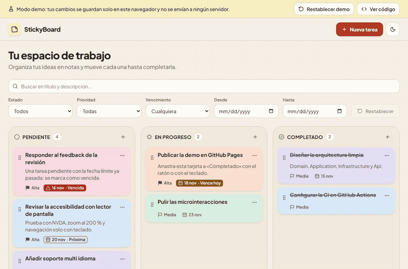
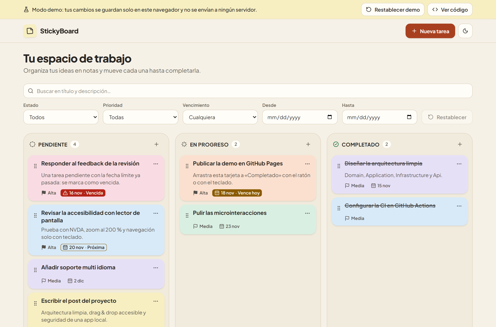
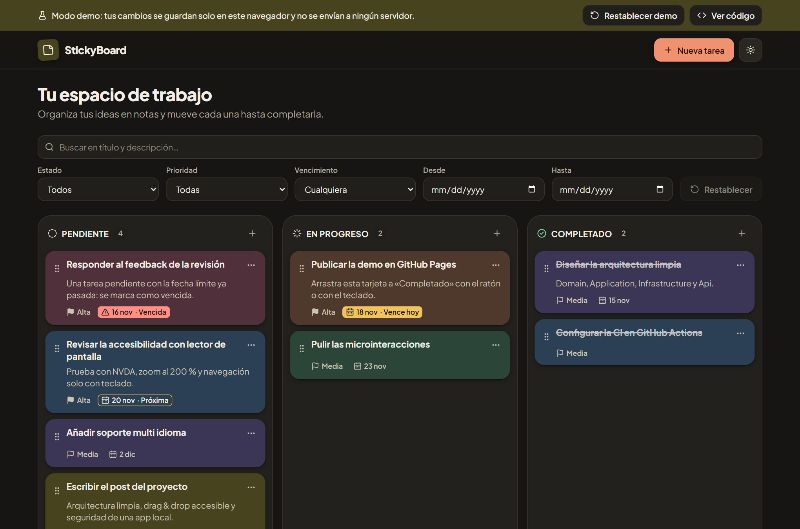
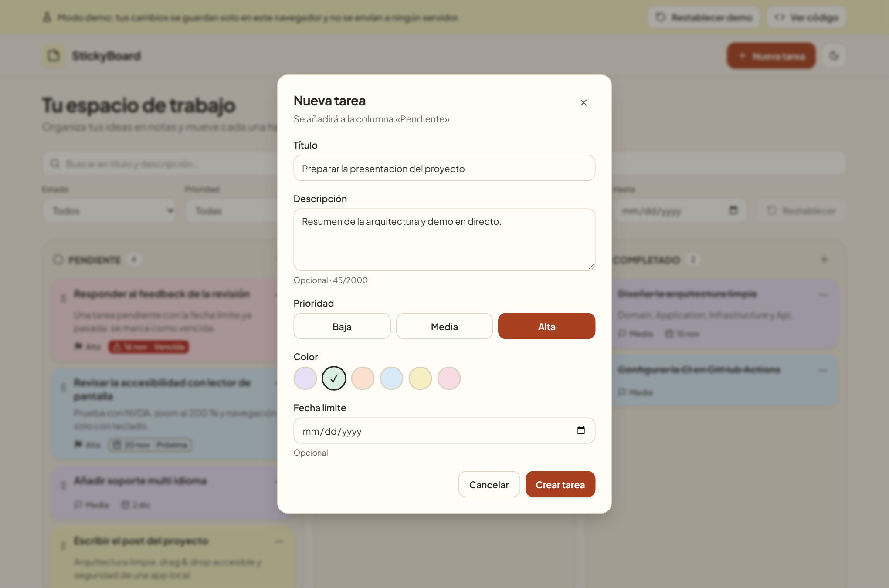
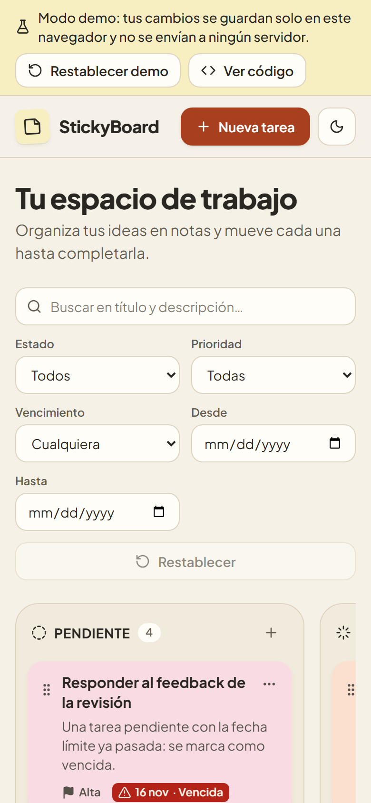
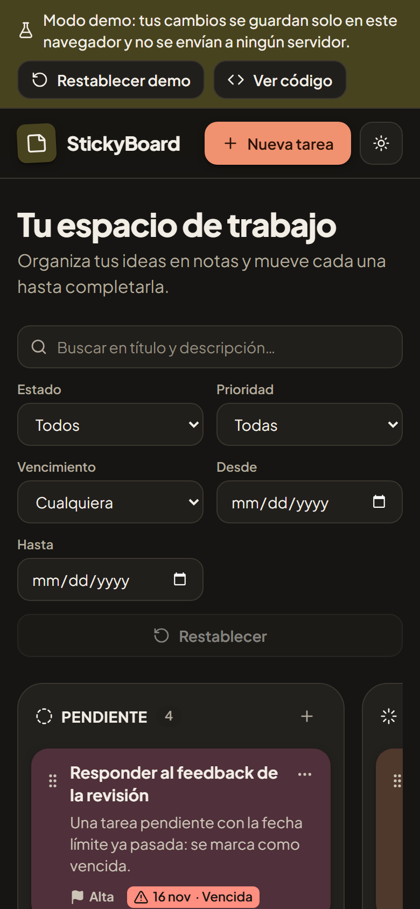
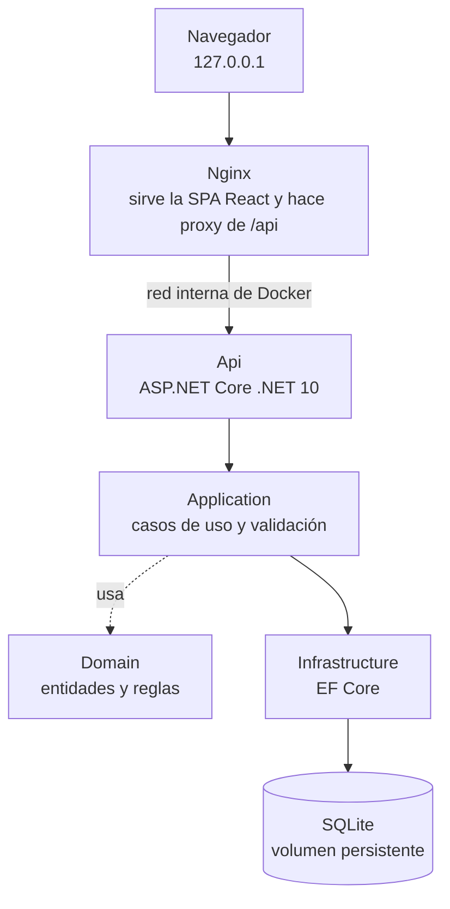

# StickyBoard

[](https://github.com/AlejBlasco/StickyBoard-Personal-Kanban-Workspace/actions/workflows/ci.yml)
[](https://alejblasco.github.io/StickyBoard-Personal-Kanban-Workspace/)
[](LICENSE)


**Tablero Kanban personal con carácter: notas de colores, drag & drop accesible, tema claro y oscuro, y una arquitectura limpia de punta a punta.**
Se ejecuta en local (una base SQLite por instalación) y es, a la vez, un proyecto de portfolio profesional.

### 👉 [Pruébalo ahora: demo en vivo](https://alejblasco.github.io/StickyBoard-Personal-Kanban-Workspace/)

La demo no tiene servidor: tus cambios se guardan solo en tu navegador y hay un botón para restablecer los datos de ejemplo. Cómo y por qué: [ADR 0003](docs/adr/0003-demo-mode.md).



## Capturas

| Tema claro | Tema oscuro |
|---|---|
|  |  |

| Crear una tarea | Móvil (claro) | Móvil (oscuro) |
|---|---|---|
|  |  |  |

## Qué hace

- **Tres columnas:** Pendiente, En progreso y Completado. Las tareas completadas siguen visibles y se pueden recuperar.
- **Drag & drop** entre columnas y dentro de una columna, con alternativa por teclado, anuncios para lectores de pantalla y un menú «Mover a».
- **Fecha límite** con indicadores de vencida, hoy y próxima; **prioridad** baja, media o alta (con icono y texto, no solo color); **6 colores** de tarjeta.
- **Búsqueda** por título y descripción y **filtros combinables** por estado, prioridad, vencimiento y rango de fechas.
- **Tema claro y oscuro** diseñados por separado (no es una simple inversión), responsive y con `prefers-reduced-motion`.
- **Borrado permanente con confirmación** y estados de carga, vacío, error y sin resultados.

## Lo que quiero destacar

- **Clean Architecture en .NET 10:** `Domain`, `Application`, `Infrastructure` y `Api`, con casos de uso independientes de EF Core, DTOs explícitos y errores en Problem Details (RFC 9457).
- **UI optimista con rollback:** al mover una tarjeta la interfaz responde al instante y se revierte si la API falla; el servidor es la autoridad sobre el orden.
- **Accesibilidad como requisito:** objetivo WCAG 2.2 AA, comprobado con axe en ambos temas dentro del E2E, navegación completa por teclado y objetivos táctiles.
- **Seguridad pensada para una app local:** web solo en `127.0.0.1`, API sin puertos publicados y en una red interna sin salida, contenedores sin root y de solo lectura, CSP y cabeceras en Nginx, validación de `Host` y `Origin`, imágenes fijadas por digest y escaneo con Trivy. Ver [SECURITY.md](docs/SECURITY.md).
- **Más de 130 pruebas automatizadas** (xUnit, Vitest + Testing Library y Playwright) y una **CI en GitHub Actions** que también construye la imagen de Docker, comprueba el endurecimiento y audita dependencias.
- **Decisiones documentadas:** [ADR](docs/adr/) para cada decisión añadida durante la implementación y documentación de arquitectura, API, modelo de datos, diseño y despliegue en [docs/](docs/INDEX.md).

## Arquitectura



Más detalle en [docs/ARCHITECTURE.md](docs/ARCHITECTURE.md).

## Stack

| Capa | Tecnología |
|---|---|
| Frontend | React + TypeScript (strict) + Vite |
| Estilos y componentes | Tailwind CSS, Radix UI personalizado, Lucide, Motion |
| Drag & drop | dnd-kit |
| Estado de servidor | TanStack Query ([ADR 0001](docs/adr/0001-tanstack-query.md)) |
| Backend | ASP.NET Core .NET 10, REST |
| Persistencia | SQLite + Entity Framework Core |
| Empaquetado | Docker Compose + Nginx |
| Pruebas | xUnit, Vitest + Testing Library, Playwright + axe |
| CI/CD | GitHub Actions (CI y despliegue de la demo en GitHub Pages) |

## Cómo ejecutarlo

### Opción 1: la demo (sin instalar nada)
Abre la [demo en vivo](https://alejblasco.github.io/StickyBoard-Personal-Kanban-Workspace/).

### Opción 2: con Docker (la aplicación completa)

```bash
docker compose up -d --build   # http://127.0.0.1:8080
```

El MVP es **local-only**: la interfaz se publica únicamente en `127.0.0.1` y la API solo es accesible desde la red interna de Compose. No debe exponerse a LAN o Internet sin completar antes el gate de [docs/SECURITY.md](docs/SECURITY.md). Persistencia, backup y restauración en [docs/DEPLOYMENT.md](docs/DEPLOYMENT.md).

### Opción 3: desarrollo local

Requisitos: .NET 10 SDK y Node.js LTS.

```bash
# API (SQLite en data/stickyboard.db)
dotnet run --project src/StickyBoard.Api --urls http://127.0.0.1:5000

# Frontend (http://127.0.0.1:5173, con proxy de /api hacia la API)
cd frontend && npm install && npm run dev
```

Pruebas: `dotnet test` (backend), `npm test` (componentes), `npm run e2e` (Playwright, arranca su propia API con una base temporal) y `npm run e2e:demo` (la build de la demo, sin API). Demo en local: `npm run dev:demo`.

## Documentación

[docs/INDEX.md](docs/INDEX.md) reúne la arquitectura, el diseño, la API, el modelo de datos, las pruebas, la seguridad, el despliegue y el roadmap. Para contribuir, ver [CONTRIBUTING.md](CONTRIBUTING.md).

## Licencia

[MIT](LICENSE)
