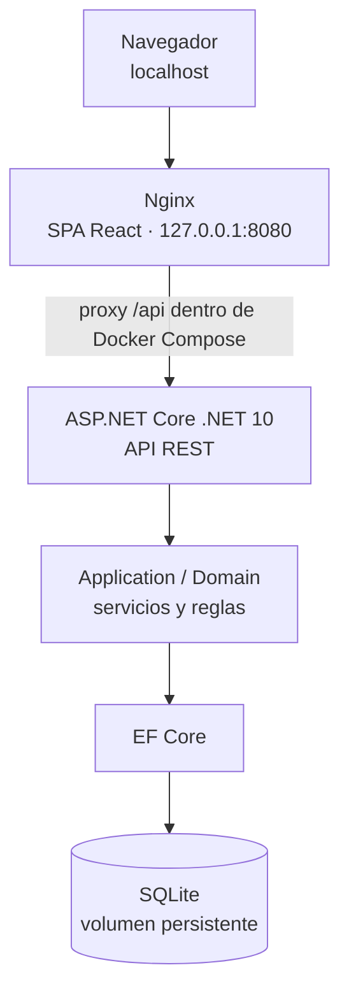
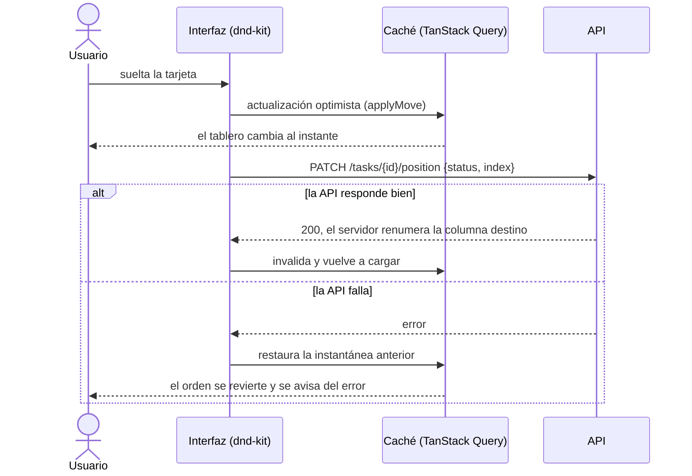
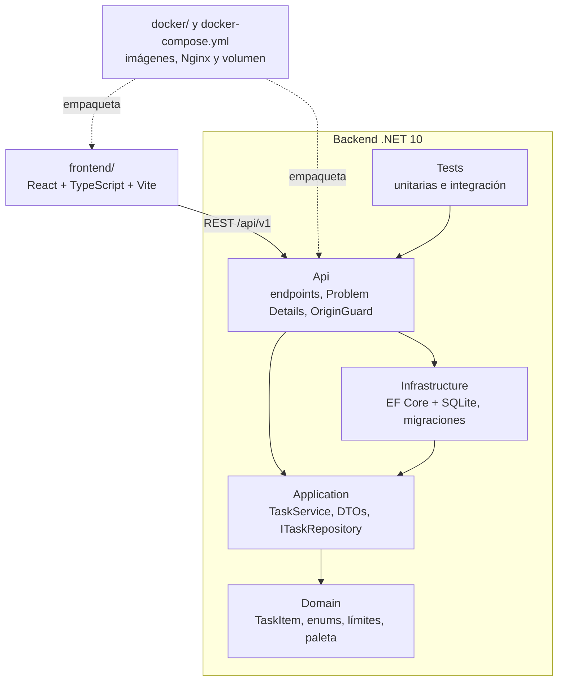
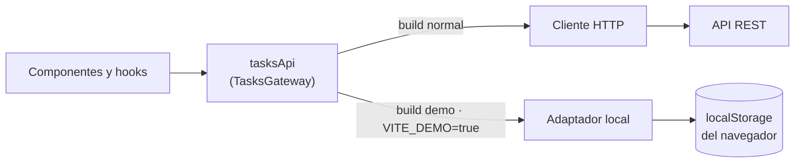

# Arquitectura

## Vista general

El navegador carga la SPA desde Nginx. Nginx reenvía `/api` al servicio API dentro de la red Docker. La API no publica un puerto en el host.

## Backend

Organizar por responsabilidades:
- **API**: endpoints, DTOs, validación HTTP y Problem Details.
- **Application**: casos de uso, reglas de transición y ordenación.
- **Domain**: entidades, enumeraciones y reglas invariantes.
- **Infrastructure**: EF Core, SQLite y repositorios si aportan valor.

Evitar capas ceremoniales sin responsabilidad real. Para el MVP, una solución modular sencilla es preferible a microservicios.

## Frontend

Organizar por funcionalidades:
- `features/board`: columnas, tablero y ordenación.
- `features/tasks`: formularios, tarjetas, hooks y operaciones.
- `features/filters`: búsqueda y filtros.
- `shared`: componentes, tokens, utilidades y cliente API.

Separar el estado de servidor del estado de interfaz. Mantener filtros, tema y diálogos en estado explícito y predecible.

## Drag & drop y orden

Usar dnd-kit. El cliente puede aplicar actualización optimista al mover una tarjeta, pero debe revertir el estado si la API falla. El backend es la autoridad final sobre el orden.

La operación de movimiento debe recibir destino y posición o una referencia equivalente estable. La API debe validar el estado destino y normalizar/recalcular posiciones de forma transaccional para evitar colisiones.

Flujo de un movimiento (actualización optimista con rollback):

## Persistencia y aislamiento

Cada instalación tiene un archivo SQLite en un volumen persistente propio. No compartir el archivo entre máquinas ni montar el mismo volumen desde varias instancias concurrentes.

Aplicar migraciones EF Core de forma controlada. Hacer backup antes de migraciones destructivas.

## Decisiones arquitectónicas

- REST en vez de comunicación en tiempo real: suficiente para una aplicación local de un usuario.
- SQLite en vez de servidor de base de datos: simple, portable y adecuada al despliegue local.
- Nginx sirve frontend y hace proxy interno de API.
- No hay cuenta, multiusuario ni sincronización en el MVP.

Registrar futuras decisiones relevantes como ADRs en `docs/adr/`.

## Implementación actual

Las flechas indican dependencias de proyecto: `Domain` no depende de nada y `Application` solo de `Domain`; `Infrastructure` implementa las interfaces de `Application`.

Frontend: `features/tasks` (API, hooks, modelo puro, tarjeta, formulario), `features/board` (columnas y dnd-kit), `features/filters` y `shared` (cliente API, UI base, hooks). La lógica de movimiento, fechas y filtros está en funciones puras (`model.ts`, `filters.ts`), probadas sin renderizar.

Modo demo: `features/tasks/api.ts` elige entre el cliente HTTP y el adaptador de navegador (`features/tasks/demo/`) según `VITE_DEMO`, decidido en tiempo de compilación.

Dependencias y decisiones añadidas durante la implementación y su motivo: ver [adr/](adr/).
