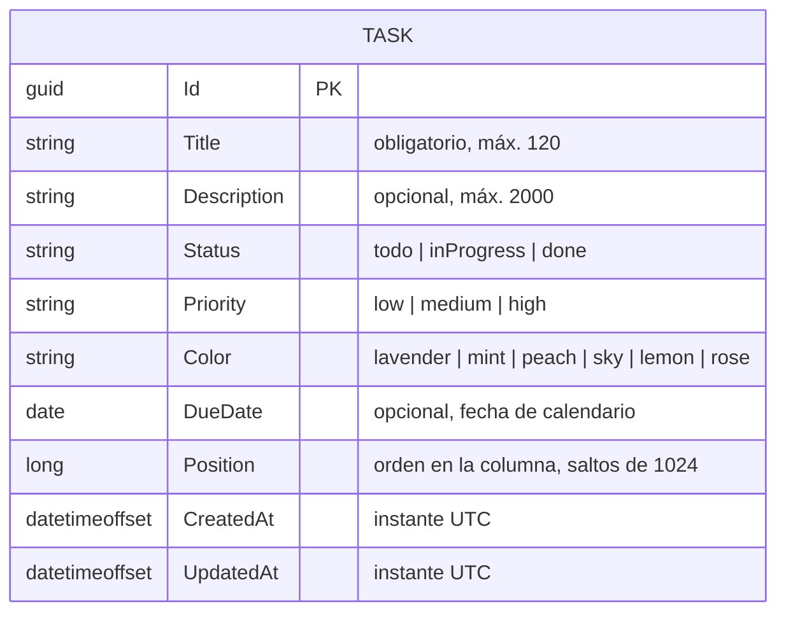
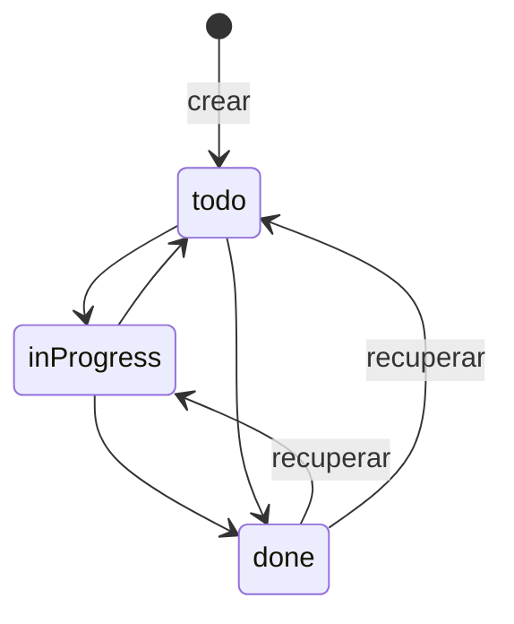

# Modelo de datos

## Entidad Task

| Campo | Tipo conceptual | Reglas |
|---|---|---|
| `Id` | Guid | Clave primaria |
| `Title` | string | Obligatorio, longitud limitada |
| `Description` | string? | Opcional, longitud limitada |
| `Status` | enum/string | `todo`, `inProgress`, `done` |
| `Priority` | enum/string | `low`, `medium`, `high` |
| `Color` | string | Clave de paleta permitida |
| `DueDate` | DateOnly? | Fecha límite opcional |
| `Position` | long/int | Orden dentro de columna |
| `CreatedAt` | DateTimeOffset | Instante UTC |
| `UpdatedAt` | DateTimeOffset | Instante UTC |

Estados de una tarea: cualquier columna puede moverse a cualquier otra, incluida la recuperación desde `done`.

## Reglas de dominio

- Título no vacío tras normalización de espacios.
- Estado y prioridad pertenecen a enumeraciones cerradas.
- Color pertenece a una paleta definida por la aplicación.
- `DueDate` no es un timestamp: representa una fecha de calendario.
- `UpdatedAt` cambia en toda modificación persistida.
- Las tareas `done` permanecen almacenadas y visibles.
- Una tarea puede volver de `done` a `todo` o `inProgress`.
- El borrado es permanente en el MVP.

## Ordenación

La posición es relativa a la columna. La implementación puede usar intervalos (por ejemplo, posiciones espaciadas) y renormalizar cuando sea necesario. La operación de movimiento debe ser transaccional y no dejar posiciones duplicadas o ambiguas.

## SQLite e índices

Índices implementados:
- `(Status, Position)` para recuperar columnas ordenadas.
- `DueDate` para consultas por vencimiento.
- `Priority` no tiene índice: no se justifica con el volumen de un tablero personal.

La búsqueda textual usa `LIKE` parametrizado sobre título y descripción, con `%`, `_` y `\` escapados para que se traten como texto literal. Evaluar FTS solo si el volumen y la experiencia lo justifican.

## Aislamiento por instalación

Cada instalación usa su propio archivo SQLite en un volumen Docker persistente. No compartir el archivo entre equipos ni asumir sincronización. Las copias de seguridad deben realizarse con procedimiento consistente y documentado.

## Valores concretos de la implementación

- `Title` ≤ 120 caracteres tras normalizar espacios; `Description` ≤ 2000.
- `Color`: `lavender` (por defecto), `mint`, `peach`, `sky`, `lemon`, `rose`.
- `Status` y `Priority` se guardan como texto (`Todo`, `InProgress`, `Done`; `Low`, `Medium`, `High`) y se exponen en la API como `todo`, `inProgress`, `done`; `low`, `medium`, `high`.
- `Position`: saltos de 1024. Al mover, la columna destino se renumera; la de origen conserva huecos, que son válidos mientras el orden se mantenga y no haya duplicados.
- Migración inicial `InitialCreate` (en `src/StickyBoard.Infrastructure/Persistence/Migrations`), aplicada automáticamente al arrancar la API.
