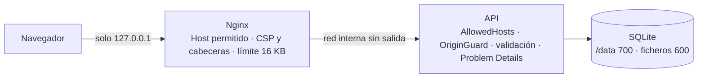

# Seguridad

## Alcance y modelo de despliegue

El MVP está diseñado para uso local en una sola máquina. La aplicación se ejecuta mediante Docker Compose; la web se publica en loopback (`127.0.0.1`) y la API permanece en la red interna de Compose. Cada instalación tiene una base de datos independiente.

Este alcance reduce exposición, pero **no convierte la aplicación en segura frente a cualquier proceso local, usuario del sistema operativo o compromiso del host**.

## Activos y amenazas

Activos principales:
- Contenido de tareas y metadatos personales.
- Archivo SQLite y copias de seguridad.
- Integridad de posiciones y estados del tablero.
- Disponibilidad de la aplicación.

Amenazas relevantes:
- Entradas maliciosas que exploten XSS, inyección o errores de validación.
- Acceso desde sitios web externos al servicio local (incluidos ataques de tipo DNS rebinding o CSRF).
- Dependencias vulnerables o cadena de suministro comprometida.
- Acceso no autorizado al archivo SQLite o al host.
- Exposición accidental de puertos o datos en logs.

## Controles obligatorios en MVP

- Validación de entrada en backend: longitud, formatos, enumeraciones y límites.
- Consultas parametrizadas mediante EF Core; nunca concatenar SQL con datos del usuario.
- DTOs de entrada/salida; no binding directo de entidades EF.
- Codificación contextual de salida y evitar HTML arbitrario.
- Política de seguridad de contenido (CSP) apropiada para la aplicación.
- Configuración explícita de hosts/orígenes permitidos y protección frente a acceso cross-origin a servicios locales.
- No habilitar CORS permisivo (`*`) con credenciales.
- La API no publica puertos al host.
- La web se vincula exclusivamente a `127.0.0.1`.
- Secretos fuera del repositorio; configuración sensible por variables/secret store.
- Logs sin contenido de tareas ni datos sensibles.
- Imágenes base y paquetes fijados a versiones conocidas; escaneo de dependencias e imágenes.
- Contenedor ejecutado como usuario no root cuando sea viable y con permisos mínimos.
- SQLite y backups con permisos de sistema de archivos restrictivos.

## Gate obligatorio antes de cualquier exposición remota

**No exponer la aplicación a LAN, Internet, reverse proxy ni Cloudflare Tunnel** hasta completar y revisar, como mínimo:

1. Autenticación real (preferiblemente OIDC con proveedor adecuado).
2. Autorización server-side para cada operación y recurso.
3. Gestión segura de sesión/cookies, expiración y revocación.
4. HTTPS extremo a extremo y configuración correcta de proxy confiable.
5. Protección CSRF para operaciones autenticadas basadas en cookies.
6. Validación estricta de `Host`, `Origin` y `Referer` según el flujo.
7. CORS de mínimo privilegio.
8. Rate limiting y límites de payload.
9. Cabeceras de seguridad y CSP revisadas.
10. Gestión de secretos, auditoría y política de backups/restauración.
11. Pruebas de seguridad automatizadas y revisión manual.
12. Revisión de OWASP Top 10 y OWASP ASVS, registrando riesgos aceptados.

Cloudflare Tunnel no sustituye autenticación ni autorización de la aplicación.

## Referencias de trabajo

Usar OWASP Top 10 (edición vigente) y OWASP ASVS como marcos de revisión. Confirmar las versiones vigentes durante la implementación; no asumir que una lista de controles por sí sola equivale a una auditoría.

## Respuesta ante incidentes

Ante indicios de exposición accidental:
1. Detener el servicio o retirar el binding público.
2. Preservar logs técnicos sin difundir contenido de tareas.
3. Identificar alcance, datos afectados y duración.
4. Rotar credenciales/secrets si existieran.
5. Corregir la causa y añadir una prueba de regresión.

## Estado de implementación de los controles del MVP

Controles en el camino de una petición:

Implementados y verificados (ver `DEPLOYMENT.md` y el job `docker` de la CI):
- Validación server-side, EF Core parametrizado, DTOs y Problem Details sin detalles internos.
- CSP restrictiva, `X-Content-Type-Options`, `X-Frame-Options`, `Referrer-Policy`, COOP/CORP y `Permissions-Policy` en Nginx; el script del tema es un fichero externo.
- `Host` validado en Nginx (respuesta vacía para hosts desconocidos) y en la API (`AllowedHosts`); `Origin` de las escrituras validado contra `Security:AllowedOrigins` (403). Sin CORS.
- API sin puertos publicados y en una red interna sin salida; web solo en `127.0.0.1`.
- Contenedores sin root, sistema de ficheros de solo lectura, `cap_drop: ALL`, `no-new-privileges`; `/data` con modo `700` y ficheros `600` en volúmenes nuevos.
- Imágenes fijadas por digest, versiones NuGet y npm exactas, `npm audit`, auditoría NuGet y Trivy en la CI.
- Límite de body de 16 KB; logs sin contenido de tareas.

Fuera del alcance del MVP y obligatorio antes de cualquier exposición remota: todo el gate anterior (autenticación, autorización, HTTPS, rate limiting, CSRF con sesión, revisión ASVS).
