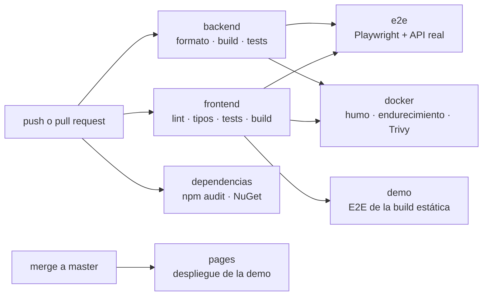

# Estrategia de pruebas

## Objetivos

Verificar reglas de negocio, contratos HTTP, persistencia, experiencia de usuario, accesibilidad y límites de despliegue. Las pruebas deben ser deterministas y no depender de servicios externos.

## Backend

Herramientas:
- xUnit para pruebas unitarias.
- `WebApplicationFactory` para pruebas de integración.
- SQLite temporal o en memoria con configuración compatible para validar persistencia.

Casos mínimos:
- Crear tarea con título válido.
- Rechazar título vacío o fuera de límites.
- Editar descripción, prioridad, color y fecha límite.
- Transiciones entre los tres estados.
- Completado permanece visible y puede recuperarse.
- Eliminar tarea y devolver resultado coherente.
- Buscar por título y descripción.
- Combinar filtros de estado, prioridad y fecha límite.
- Reordenar dentro de columna y mover entre columnas.
- Mantener consistencia de posiciones en operaciones concurrentes razonables.
- Persistencia tras reiniciar el host.
- Errores con formato Problem Details.

## Frontend

Herramientas:
- Vitest.
- React Testing Library.
- Playwright para E2E.

Casos mínimos:
- Render de las tres columnas.
- Crear, editar y eliminar con confirmación.
- Mover y reordenar mediante drag & drop.
- Alternativa accesible por teclado.
- Búsqueda y filtros combinados.
- Mostrar tareas completadas y permitir recuperarlas.
- Indicador de fecha vencida y fecha próxima.
- Cambio de tema claro/oscuro.
- Estados loading, error y empty.
- Diseño responsive y controles táctiles.

## Accesibilidad

Validar:
- Navegación completa por teclado.
- Orden de foco y foco visible.
- Etiquetas y nombres accesibles.
- Contraste de texto, controles y estados.
- No depender solo del color para prioridad/estado.
- Anuncios accesibles para acciones de drag & drop.
- Zoom y reflow.
- Objetivo WCAG 2.2 AA.

## Seguridad y despliegue

- Validación server-side y límites de payload.
- Entradas con caracteres especiales y cadenas largas.
- No exposición del puerto API en `docker compose ps`.
- Web publicada únicamente en loopback.
- Persistencia del volumen tras recreación de contenedores.
- Escaneo de dependencias e imágenes.
- Comprobación de configuración de host/origin y CSP.

## Criterio de aceptación

No marcar una prueba como superada sin ejecutarla y registrar el resultado. Los fallos conocidos deben documentarse con impacto y seguimiento.

## Estado actual y cómo ejecutarlo

| Capa | Herramienta | Cobertura | Comando |
|---|---|---|---|
| Backend unitarias | xUnit | 52 tests de `TaskItem` y `TaskService` (repositorio y reloj falsos) | `dotnet test` |
| Backend integración | xUnit + `WebApplicationFactory` + SQLite temporal | 21 tests: CRUD, movimiento, filtros, Problem Details, `Host` y `Origin` | `dotnet test` |
| Frontend | Vitest + React Testing Library | 47 tests: modelo, filtros, validación, adaptador de la demo y flujos de la aplicación (API simulada y modo demo) | `npm test` (en `frontend/`) |
| E2E | Playwright contra la API real | 8 tests: CRUD, drag & drop con ratón y teclado, filtros, ambos temas con axe (WCAG 2.2 AA) y móvil | `npm run e2e` |
| E2E demo | Playwright contra la build estática de la demo | 7 tests: sin llamadas a `/api`, CRUD y persistencia en `localStorage`, arrastre, filtros, restablecer y axe en ambos temas | `npm run e2e:demo` |
| Despliegue | CI (job `docker`) y `docs/DEPLOYMENT.md` | Puertos, usuario no root, `Host`/`Origin`, persistencia, CSP y Trivy | `.github/workflows/ci.yml` |

Pipeline de la CI (`.github/workflows/ci.yml`) y despliegue de la demo:

El E2E también puede ejecutarse contra el stack de Docker con `E2E_BASE_URL=http://127.0.0.1:8080 npm run e2e`. **Borra las tareas existentes**: usa un proyecto Compose aparte (por ejemplo `docker compose -p sbverify`).

La CI se ejecuta en GitHub en cada PR: 6 jobs más el check del título (los 7 son obligatorios para fusionar). Pendiente: revisión manual con lector de pantalla ([#6](https://github.com/AlejBlasco/StickyBoard-Personal-Kanban-Workspace/issues/6)).
